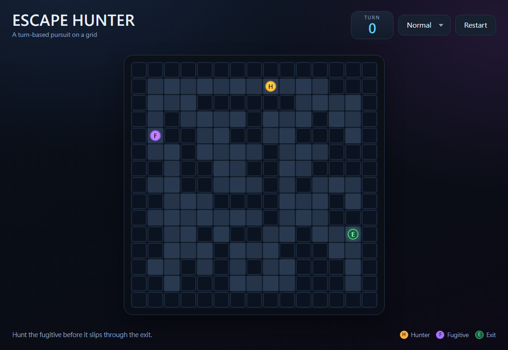
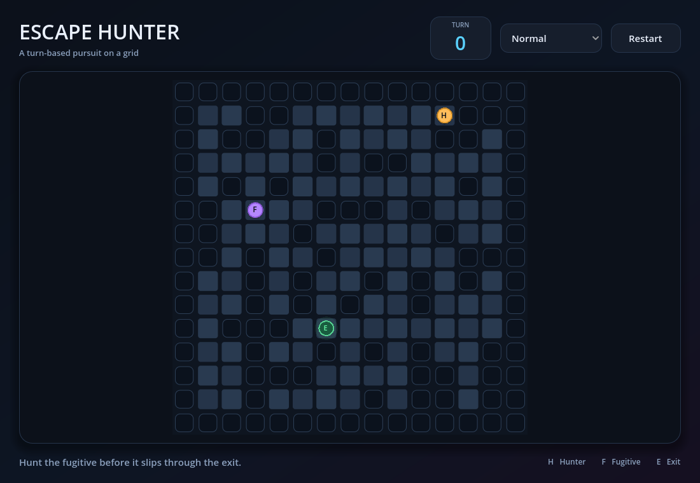
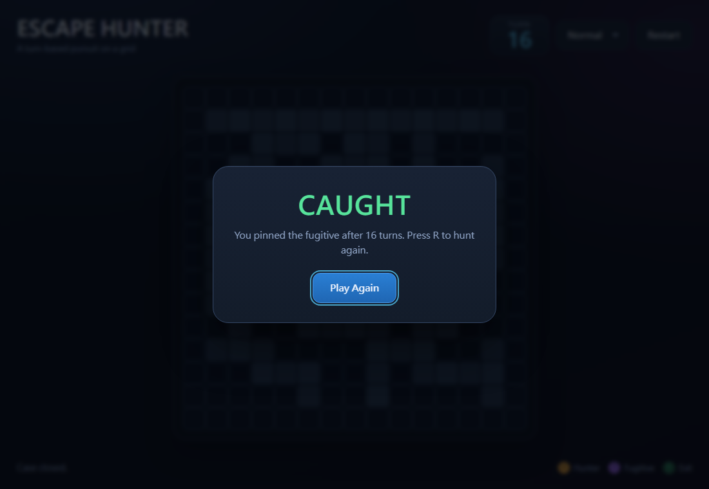

# Escape Hunter

A complete turn-based pursuit game in two forms:

- **One file, zero setup** — [`index.html`](index.html) runs the whole game in
  any modern browser, offline, with no build step or dependencies.
- **Godot 4 project** — the same rules, look and AI as a native project.

The board is **15 × 15** with roughly **40% walls**, one hunter (the cop) and
one fugitive. Random mazes always connect, and the fugitive gets tired, so
chases end in a capture or a clean escape instead of an endless draw.



## Play in the browser

Open [`index.html`](index.html) — double-click it, or drag it into a browser
tab. There is no server, no package install and no external asset: the whole
game is inline HTML, CSS and JavaScript.

| Input | Action |
| --- | --- |
| Arrow keys / WASD | Move the hunter one tile |
| Tap a neighbouring tile | Move the hunter there |
| Swipe on the board | Move in the swipe direction |
| On-screen D-pad (narrow screens) | Move the hunter |
| R | Restart with a new random map |
| Difficulty dropdown | Switch AI tier (applies from the fugitive's next move) |
| Restart / Play Again | New map, turn counter back to 0 |

Add `?seed=123` to the URL for a reproducible map, e.g.
`index.html?seed=42`.

## Godot 4 project

The native build needs Godot **4.3** or newer (standard build, no C#). Import
[`project.godot`](project.godot), then press **F5**; from a terminal:

```bash
godot --path .
```

It uses the *GL Compatibility* renderer and draws the board procedurally, so
there is no tileset or sprite import step.



## Rules

1. The hunter moves one tile (walls block movement).
2. If the hunter shares the fugitive's tile, the hunter wins immediately.
3. The fugitive moves one tile.
4. Every fifth hunter turn the fugitive is out of breath and misses its move.
5. If the fugitive stands on an exit, the fugitive wins.
6. Repeat.

The turn counter increments on every hunter move. The fugitive cannot step
onto the hunter's tile, and the AI plans around the hunter's position.

Rule 4 is the anti-draw rule. At equal speed a perfect evader can circle a
loop forever, so it now has to hand the hunter a free step every five turns.
That makes a capture genuinely reachable without turning the chase into a
walkover; in 100 simulated hunts every game finished.

When the hunt ends the result card names the winner and offers a fresh map:



## AI tiers

| Tier | Behaviour |
| --- | --- |
| **Easy** | Uniform random legal move. |
| **Normal** | Breadth-first exit distance field; steps to the neighbour closest to the nearest exit. |
| **Hard** | Same exit pull, plus a threat cost for tiles within two tiles of the hunter (Chebyshev distance), so it slides around you instead of into you. |
| **Expert** | A* route to the nearest exit, scored with a 3-turn pursuit simulation against a perfect chaser, a dead-end penalty, and a bonus for keeping several forward escape routes open. |

Two details keep the chase from becoming a dance:

- Normal, Hard and Expert remember the last four tiles they left and avoid
  pacing between the same two cells.
- After a while the fugitive stops dodging and commits to the exit — after 8
  turns on Easy, 14 on Normal, 20 on Hard and 30 on Expert.

The Expert tier also treats every tile next to the hunter as almost forbidden
while it still has room to dodge, which is what makes it double back and take
the long way around.

## Map generation

Both builds use the same generator:

1. Fill the board and keep a solid border.
2. Scatter walls over 40% of the interior, then join every isolated pocket to
   the main region by carving a 4-neighbour tunnel. The result is a dense maze
   that is always solvable for the same movement rules the actors use.
3. Reject the layout unless at least 85 cells are open and connected (up to
   60 attempts).
4. Place the hunter at random, then an exit at least 6 Manhattan steps away.
5. Place the fugitive at least 8 steps from the hunter and 8 from the exit,
   on a tile with two or more ways out. The strict pass also starts the hunter
   nearer the exit than the fugitive, so cutting the fugitive off is a real
   plan rather than a hopeless race. Spacing relaxes if the map is cramped.

If random generation somehow failed every attempt, the deterministic MVP
layout from the design (`FALLBACK_LAYOUT`) is used instead.

## Project structure

```
escape-hunter/
├── index.html               # complete browser build (HTML + CSS + JS)
├── project.godot
├── icon.svg
├── docs/
│   ├── screenshot-web.png
│   ├── screenshot-web-result.png
│   └── screenshot.png
├── scenes/
│   └── main.tscn            # Godot layout only: header, board frame, footer, modal
├── scripts/
│   ├── game_manager.gd      # turn state machine, win checks, wiring (scene root)
│   ├── grid_manager.gd      # tile data, neighbours, ASCII layout parser
│   ├── map_generator.gd     # random walls + spawn/exit placement
│   ├── pathfinding_system.gd# A* and BFS distance fields
│   ├── player_controller.gd # input -> one legal hunter step
│   ├── fugitive_ai.gd       # Easy / Normal / Hard / Expert policies
│   ├── board_view.gd        # Control that draws the grid and actors
│   └── hud.gd               # text, styling, difficulty picker, result modal
└── tests/
    ├── smoke_test.gd        # headless Godot logic checks
    └── web_smoke_test.js    # browser-build logic checks (Node)
```

### Responsibilities

The browser build keeps the same separation inside `index.html`:

- **Grid** — tile types, exits, bounds and neighbour queries.
- **Pathfinding** — stateless A* routes and BFS distance fields.
- **MapGenerator** — connected random walls, then spawn and exit placement.
- **FugitiveAI** — returns one destination tile per turn; never mutates state.
- **Game** — turn order, capture/exit checks, turn counter, difficulty.
- **UI section** — keyboard/pointer input, canvas drawing, HUD and the modal.

The Godot build mirrors this with nodes:

- **GameManager** owns `PLAYER_TURN`, `FUGITIVE_TURN`, `GAME_OVER` and the
  turn counter, and resolves the rules after each step.
- **PlayerController** turns key events into `move_requested` and validates a
  single step.
- **GridManager** is the level and has no idea the game exists.
- **PathfindingSystem** takes blocked tiles as an argument, which is how the
  AI models the hunter's body.
- **BoardView** draws `GridManager` state and interpolates actor positions.
- **GameHUD** writes labels and emits button signals; `GameManager` decides
  what they mean.

## Extending it

- **Bigger maps**: change `COLS`/`ROWS` and the `Grid` size in `index.html`;
  in Godot change `GRID_SIZE` in `game_manager.gd`.
- **More exits**: add `E` glyphs in a preset layout, or call the grid's
  `setTile`/`set_tile` with `EXIT`. All AI tiers and the BFS field already
  handle multiple exits.
- **More AI tiers**: add a case in `FugitiveAI.chooseMove()` (JS) and/or
  `FugitiveAI.choose_move()` (GDScript), plus names and hints.
- **Preset levels**: both grids accept ASCII layouts (`#` wall, `.` floor,
  `E` exit, `H` hunter, `F` fugitive) and return the spawns.

## Tests

Browser build (Node 18+, no packages):

```bash
node tests/web_smoke_test.js
```

Godot build:

```bash
godot --headless --path . --editor --quit   # first import (builds the class cache)
godot --headless --path . --script res://tests/smoke_test.gd
```

The suites check layout parsing, A* and BFS behaviour, generated maps (spawns,
reachable exit, solvability), every AI tier's move legality, and the capture /
exit end conditions. The browser suite also plays scripted battles to make
sure no AI gets stuck.
