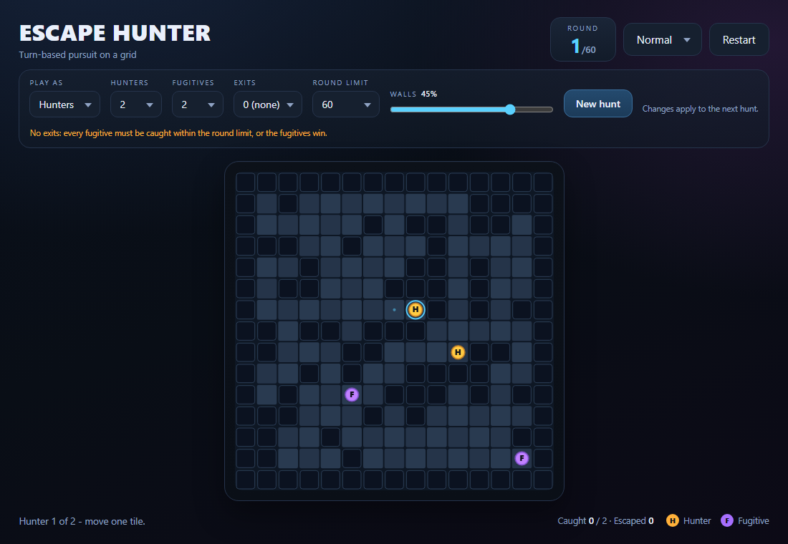
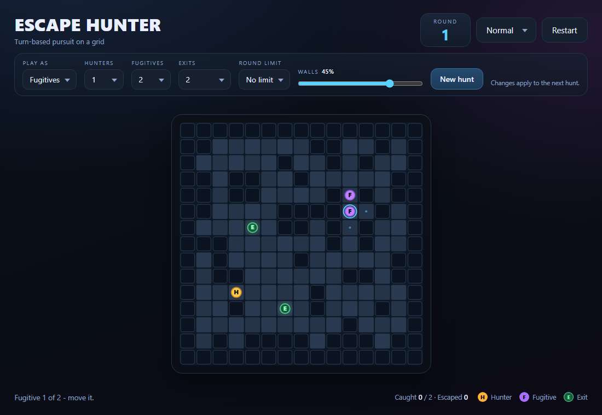

# Escape Hunter

A turn-based pursuit game in two forms:

- **One file, zero setup** — [`index.html`](index.html) runs the whole game in
  any modern browser, offline, with no build step or dependencies.
- **Godot 4 project** — a native port of the original 1 hunter vs 1 fugitive
  hunt.

The board is **15 × 15**. In the browser build you choose whether to play as
the **hunters** or the **fugitives**, how many of each (1–5), **0–5 exits**,
an optional **round limit**, and **0–60% walls**. Hunters act in a fixed
rotation; every active fugitive answers each round. Random mazes are always
connected, so the chase is decided by positioning, not by a sealed-off spawn.


## Play in the browser

Open [`index.html`](index.html) — double-click it, or drag it into a browser
tab. There is no server, no package install and no external asset: the whole
game is inline HTML, CSS and JavaScript.

### Setup panel

| Setting | Range | Effect |
| --- | --- | --- |
| **Play as** | Hunters / Fugitives | Which side you control. |
| **Hunters** | 1–5 | Hunters in play. They move one at a time in a fixed rotation. |
| **Fugitives** | 1–5 | Fugitives in play. Every active fugitive moves each round. |
| **Exits** | 0–5 | How many exit tiles are placed. Each gets a clear 3×3 doorstep. 0 means no exit at all. |
| **Round limit** | No limit, 10–200 | Rounds allowed to catch every fugitive. If the last one is still free when they run out, the fugitives win. |
| **Walls** | 0–60% | Wall coverage. 0% is a completely open room; 60% is a dense maze. |
| **Difficulty** | Easy–Max | Skill of the side the AI controls. |

**No exits means no escape.** Setting exits to 0 removes every exit tile, so
the fugitives can only win by surviving. A hunt like that would never end on
its own, so it always carries a round limit: with 0 exits the game uses the
default **60 rounds**, and "No limit" is not offered. With one or more exits
the round limit is optional.

**Round limit.** If the round limit is reached and any fugitive is still free,
the hunt ends on the clock and the fugitives win — a timeout is not an escape,
and it is reported separately from one. The limit is counted in rounds: one
round is one hunter move plus one move from every active fugitive. The HUD
shows it as `round / limit`, so a 2v2 hunt at a 30-round limit means each
hunter gets 15 moves.

**New hunt** (or **Restart**, or **R**) starts a fresh map with the current
settings. Settings are remembered in `localStorage`, and `?seed=123` in the
URL makes the map reproducible.



### Controls

| Input | Action |
| --- | --- |
| Arrow keys / WASD | Move the unit whose turn it is |
| Click / tap a neighbouring tile | Move the active hunter, or the selected fugitive |
| Click / tap a fugitive (playing as fugitives) | Select that fugitive |
| 1–5 | Select one of your fugitives (fugitive side only) |
| Swipe on the board | Move the active unit in that direction |
| On-screen D-pad (narrow screens) | Move the active unit |
| R | New hunt |
| Difficulty dropdown | Switch AI tier immediately |

The hunter whose turn it is has a cyan ring and blue dots on its legal steps —
you cannot choose a different hunter; the rotation decides. When you play as
the fugitives, the ring is on the fugitive you have selected, and each active
fugitive may move once per round.



## How a round works

The same sequence runs for both sides; only who controls each phase changes.

1. **Hunter phase.** One hunter acts — the next one in the rotation. You move
   it when playing hunters; the AI moves it when playing fugitives. A boxed-in
   hunter skips its turn.
2. **Fugitive phase.** Every active fugitive moves one tile. You move them
   when playing fugitives; the AI moves them when playing hunters. Fugitives
   cannot step onto a hunter or onto each other.
3. Stepping onto a fugitive captures it. A fugitive that reaches **any** exit
   escapes, and the first escape decides the hunt immediately.
4. **Round limit.** When the last fugitive of the round has moved and the limit
   has been reached with anyone still free, the hunt ends and the fugitives
   win.

The hunt ends **immediately** when either side has won:

- **CAUGHT** — every fugitive was caught. The hunters win.
- **ESCAPED** — a fugitive reached the exit. The fugitives win.
- **TIME'S UP** — the round limit ran out with a fugitive still free. The
  fugitives win, even if some of them were caught earlier.

The result card shows **YOU WIN** or **YOU LOSE** from your side, and the
footer tally updates live: caught / total and escaped.


There is no fatigue rule. At equal speed a perfect evader can keep circling, so
a hunt without a limit can run very long: hunters win by cutting off the exit
and using dead ends. Set a **round limit** to decide the hunt on the clock, or
set **Exits** to 0, which forces one. If a chase stalls, **New hunt** (or
**R**) starts a fresh map.

## Tuning the odds

Some starting points:

- **Hunter, 1 vs 1, 40%** — the tight duel. Cutting the exit off is essential;
  a straight chase can go on for a long time.
- **Hunter, 3 vs 2, 55%** — a tactical sweep; the rotation means only one
  hunter acts per round, so position the others for later turns.
- **Hunter, 2 vs 1, 40%, no exits, 60 rounds** — the arena. There is no door to
  guard, so use the clock: herd the runner into dead ends before it runs out.
- **Hunter, 1 vs 2, 40%, 3 exits, 40 rounds** — with three doors and a clock,
  the hunters must split coverage and still catch everyone in time.
- **Fugitive, 1 vs 2, 45%** — split the fugitives up and time a run for the
  exit while the AI hunter is busy.
- **Fugitive, 1 vs 3, 30%** — one hunter, three fugitives and an open map: a
  good place to practise dodging.
- **Fugitive, 1 vs 1, 0%, no exits, 40 rounds** — pure survival in an open
  room; keep the hunter behind you until the clock runs out.

More walls means more dead ends (good for hunters) but also more hiding
routes. Fewer walls favours the fugitives; 0% is a pure open-field chase.
More exits also favours the fugitives: hunters can no longer guard a single
door, and one escape is enough. Zero exits flips that: the fugitives can only
win on the clock, so the hunters trade a door to guard for a hard deadline.

## Godot 4 project

The native build is the original 1 hunter vs 1 fugitive hunt: 15 × 15, 40%
walls, one exit, the original Easy–Expert tiers, but no setup panel, no side
selection, no Max tier, no round limit and no fatigue rule. It needs Godot
**4.3** or newer (standard build, no C#). Import [`project.godot`](project.godot), then press **F5**; from
a terminal:

```bash
godot --path .
```

It uses the *GL Compatibility* renderer and draws the board procedurally, so
there is no tileset or sprite import step.


## AI tiers

| Tier | Behaviour |
| --- | --- |
| **Easy** | Uniform random legal move. |
| **Normal** | Breadth-first exit distance field; steps to the neighbour closest to the nearest exit. |
| **Hard** | Same exit pull, plus a threat cost from the nearest hunter, so it slides around the hunters instead of into them. |
| **Expert** | A* route to the nearest exit, scored with a 3-turn pursuit simulation against *all* hunters, a dead-end penalty, and a bonus for keeping several forward escape routes open. |
| **Max** | Searches the next three rounds as a game tree: the hunters answer with their best move, the fugitive answers back, and the move that holds up across the whole line is played. |

More details:

- Normal, Hard, Expert and Max remember the last four tiles they left and
  avoid pacing between the same two cells.
- After a while the fugitive stops dodging and commits to the exit — after 8
  rounds on Easy, 14 on Normal, 20 on Hard and 30 on Expert.
- The Expert tier treats every tile next to any hunter as almost forbidden
  while it still has room to dodge.
- With **no exits** on the board, Normal, Hard and Expert switch to evasion:
  they step as far from the hunters as possible, prefer open cells over dead
  ends, and Expert adds a 3-turn survival simulation. Easy just wanders. Max
  keeps its adversarial search, so it still plays the survival line.
- **Max** is a search, not a scoring rule. It plays the next three rounds as
  a game tree (hunter reply, then fugitive reply), values exits and survival
  margins at the leaves, and uses the one-step evaluation as a tie-break so it
  keeps making progress instead of pacing. The hunter Max search runs four
  rounds deep because the rotation means a different hunter moves each round.

When you play as the fugitives, the AI controls the hunters instead:

| Hunter AI | Behaviour |
| --- | --- |
| **Easy** | Picks a random legal move. |
| **Normal** | Chases the nearest fugitive with A*. |
| **Hard / Expert** | Tries to reach a point on the fugitive's exit route before the fugitive gets there, and chases hard otherwise. With no exits, they simply chase. |
| **Max** | Searches four rounds ahead and plans the hunter rotation: it scores each step against the fugitive's best escape route, denies the earliest intercept point, and closes in once the exit is cut off. |

## Map generation

The browser build uses the settings above; the Godot build uses 40% walls.

1. Fill the board and keep a solid border.
2. Scatter walls over the requested percentage of the interior, then join every
   isolated pocket to the main region by carving a 4-neighbour tunnel. The
   result is a dense maze that is always solvable for the actors' movement
   rules.
3. Reject the layout unless enough cells are open and all floor tiles are
   connected (up to 80 attempts).
4. Place the exit tiles at random, at least one cell from the border. Every
   exit keeps its eight neighbouring cells clear, so an exit is never walled
   in. With zero exits this step places nothing and the hunt falls back on the
   round limit. Place the hunters and fugitives on distinct floor tiles so that
   fugitives start at least 6 steps from every hunter and from the nearest
   exit, no hunter starts within 2 steps of an exit, and at least one hunter
   starts closer to each fugitive's nearest exit than that fugitive. These
   gaps relax if the map is cramped.
5. If generation somehow fails, an open fallback arena is used.

## Project structure

```
escape-hunter/
├── index.html               # complete browser build (HTML + CSS + JS)
├── project.godot
├── icon.svg
├── docs/
│   ├── screenshot-web.png
│   ├── screenshot-web-fugitive.png
│   ├── screenshot-web-no-exit.png
│   ├── screenshot-web-result.png
│   └── screenshot.png
├── scenes/
│   └── main.tscn            # Godot layout only: header, board frame, footer, modal
├── scripts/
│   ├── game_manager.gd      # turn state machine, win checks, wiring (scene root)
│   ├── grid_manager.gd      # tile data, neighbours, ASCII layout parser
│   ├── map_generator.gd     # random walls + spawn/exit placement
│   ├── pathfinding_system.gd# A* and BFS distance fields
│   ├── player_controller.gd # input -> one legal hunter step
│   ├── fugitive_ai.gd       # Easy / Normal / Hard / Expert policies
│   ├── board_view.gd        # Control that draws the grid and actors
│   └── hud.gd               # text, styling, difficulty picker, result modal
└── tests/
    ├── smoke_test.gd        # headless Godot logic checks
    └── web_smoke_test.js    # browser-build logic checks (Node)
```

### Responsibilities

The browser build keeps the same separation inside `index.html`:

- **Grid** — tile types, exits, bounds and neighbour queries.
- **Pathfinding** — stateless A* routes and BFS distance fields.
- **MapGenerator** — connected random walls, then actor and exit placement.
- **FugitiveAI** — returns one destination tile per fugitive per round;
  considers every hunter and the other fugitives as blocked.
- **Game** — round/phase state, round limit and timeout, hunter selection,
  captures, escapes, tallies.
- **UI section** — setup controls, keyboard/pointer input, canvas drawing, HUD
  and the result modal.

The Godot build mirrors this with nodes; **GameManager** owns the turn state,
**PlayerController** validates one step, **BoardView** draws, and **GameHUD**
owns the labels and modal.

## Tests

Browser build (Node 18+, no packages):

```bash
node tests/web_smoke_test.js
```

The browser suite checks layout parsing, A* and BFS behaviour, 300 generated
maps across wall densities (including 0%) and exit counts (including 0), exit
doorsteps, side selection and hunter rotation, both AI controllers, the
capture/escape rules, the round limit and timeout wins, the no-exit AI, Max
versus Expert strength runs, and 120 scripted battles from both sides (most
resolve; hunts with no limit can legitimately run long now that there is no
fatigue rule).

Godot build:

```bash
godot --headless --path . --editor --quit   # first import (builds the class cache)
godot --headless --path . --script res://tests/smoke_test.gd
```
