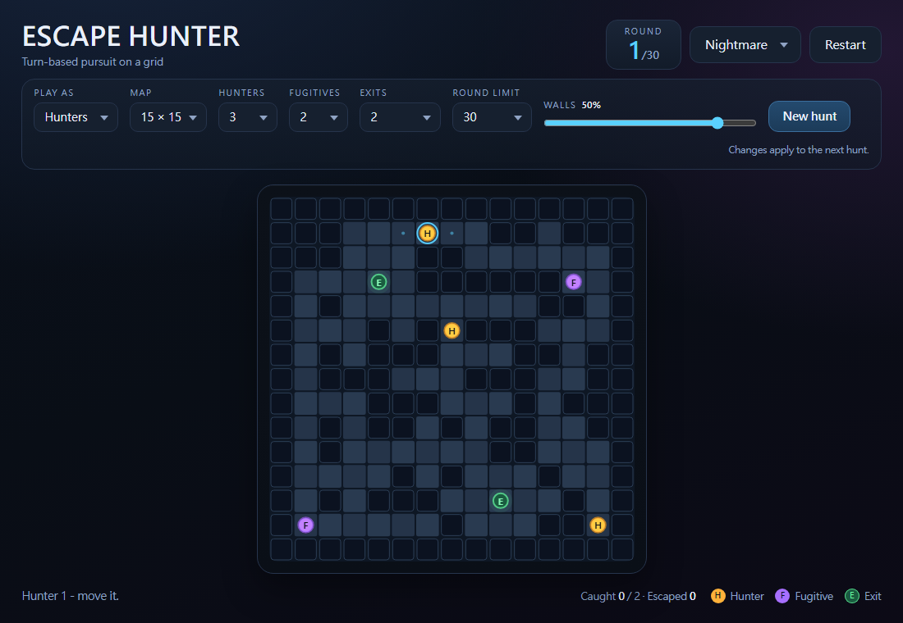
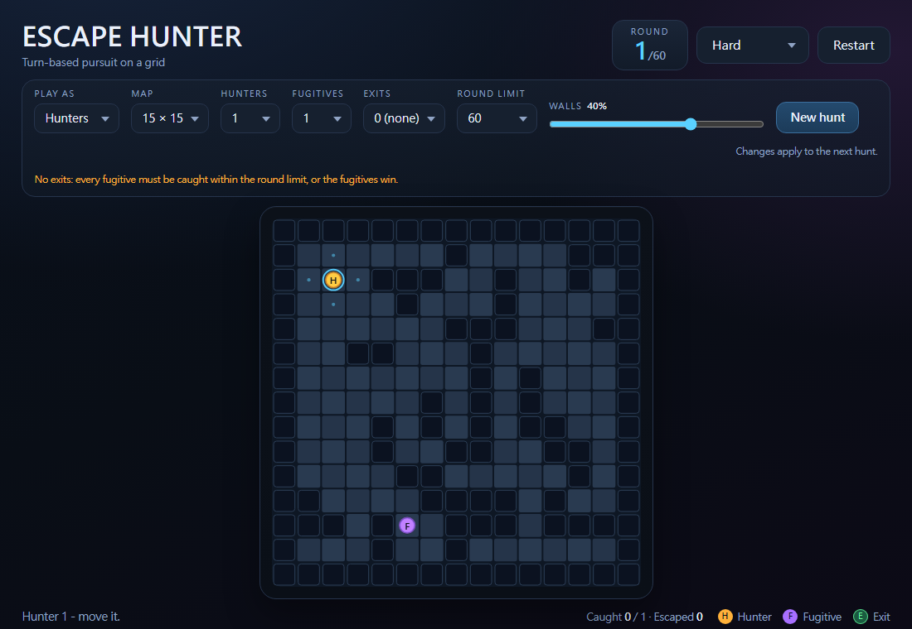
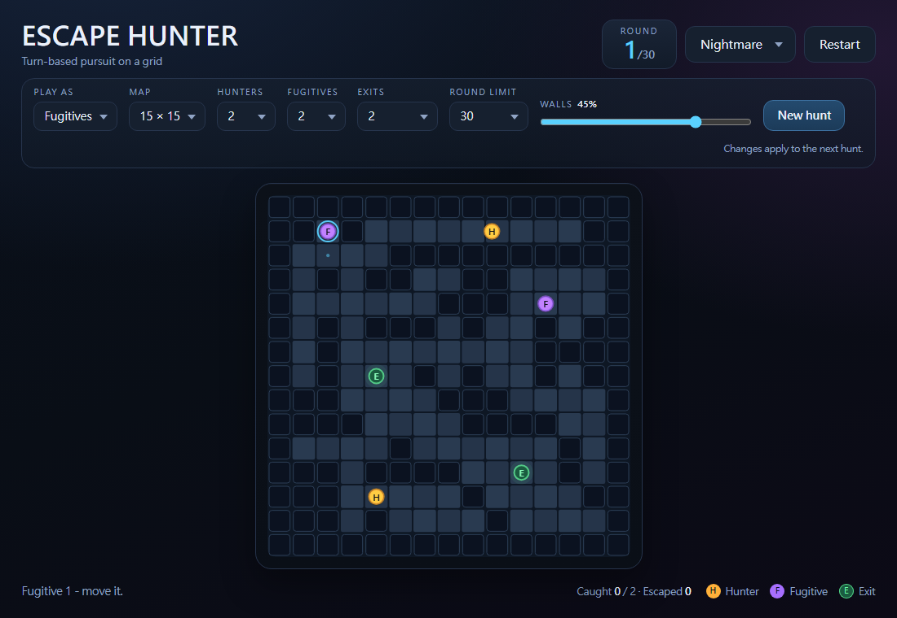
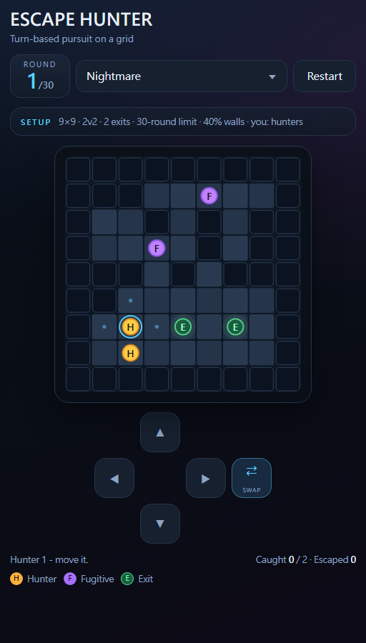
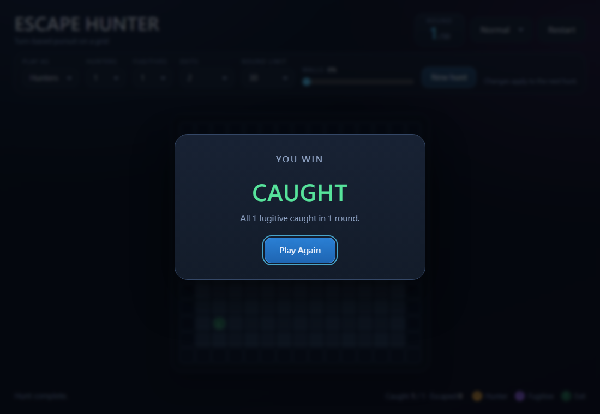
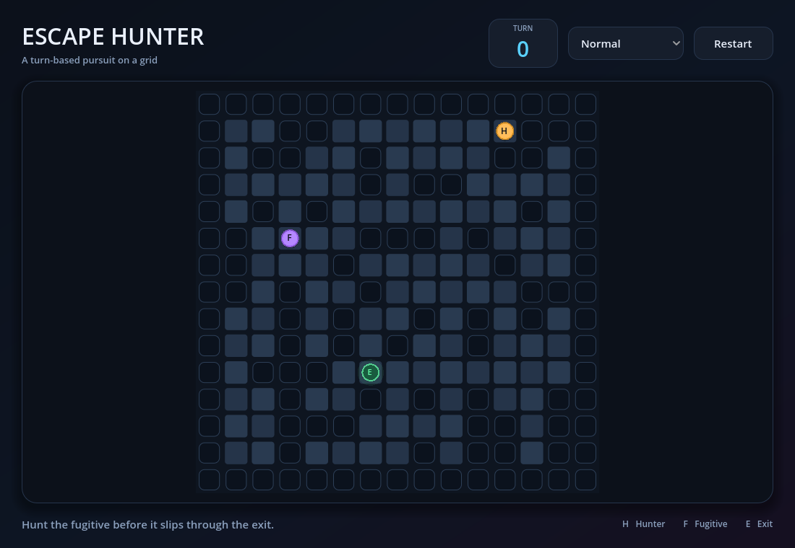

# Escape Hunter

A turn-based pursuit game in two forms:

- **One file, zero setup** — [`index.html`](index.html) runs the whole game in
  any modern browser, offline, with no build step or dependencies.
- **Godot 4 project** — a native port of the original 1 hunter vs 1 fugitive
  hunt.

The board is **9 × 9 to 19 × 19** (15 × 15 by default). In the browser build
you choose whether to play as the **hunters** or the **fugitives**, how many of
each (1–5), **0–5 exits**, an optional **round limit**, and **0–60% walls**.
Each round you pick **one** of your units to move one tile; the AI picks one of
its units. Random mazes are always connected, so the chase is decided by
positioning, not by a sealed-off spawn.



## Play in the browser

Open [`index.html`](index.html) — double-click it, or drag it into a browser
tab. There is no server, no package install and no external asset: the whole
game is inline HTML, CSS and JavaScript.

### Setup panel

| Setting | Range | Effect |
| --- | --- | --- |
| **Play as** | Hunters / Fugitives | Which side you control. |
| **Map** | 9×9–19×19 | Board size; 15×15 by default. |
| **Hunters** | 1–5 | Hunters in play. One of them moves each round. |
| **Fugitives** | 1–5 | Fugitives in play. One of them moves each round. |
| **Exits** | 0–5 | How many exit tiles are placed. Each gets a clear 3×3 doorstep. 0 means no exit at all. |
| **Round limit** | No limit, 10–200 | Rounds allowed to catch every fugitive. If the last one is still free when they run out, the fugitives win. |
| **Walls** | 0–60% | Wall coverage. 0% is a completely open room; 60% is a dense maze. |
| **Difficulty** | Easy–Nightmare | Skill of the side the AI controls. |

**New hunt** (or **Restart**, or **R**) starts a fresh map with the current
settings. Settings are remembered in `localStorage`, and `?seed=123` in the
URL makes the map reproducible.

**No exits means no escape.** Setting exits to 0 removes every exit tile, so
the fugitives can only win by surviving. Such a hunt would never end on its
own, so it always carries a clock: with 0 exits the game uses the default
**60 rounds**, and "No limit" is not offered. With one or more exits the round
limit is optional.

**Round limit.** If the limit is reached with any fugitive still free, the
hunt ends on the clock and the fugitives win — a timeout is not an escape, and
it is reported separately. One round is one hunter action plus one fugitive
action, so a 2v2 hunt at 30 rounds means each side gets 30 moves. The HUD shows
`round / limit`.



### Controls

| Input | Action |
| --- | --- |
| Arrow keys / WASD | Move the selected unit |
| Click / tap a neighbouring tile | Move the selected unit there |
| Click / tap one of your units | Select that unit |
| 1–5 | Select one of your units |
| SWAP (touchpad, right of the arrows) | Select the next movable unit |
| Swipe on the board | Move the selected unit in that direction |
| On-screen D-pad (narrow screens) | Move the selected unit |
| R | New hunt |
| Difficulty dropdown | Switch AI tier immediately |

The unit you have selected has a cyan ring and blue dots on its legal steps.
Click / tap any of your movable units to select it, or press **1–5**; then
move it one tile. On phones, the **SWAP** button to the right of the arrow pad
cycles through your movable units. The selection is free — there is no forced
order — but only one unit on your side moves per round.





## How a round works

The same sequence runs for both sides; only who controls each phase changes.

1. **Hunter phase.** One hunter moves one tile — you choose which one when you
   play hunters; the AI chooses when you play fugitives. A hunter blocked by
   walls or other hunters can be left for another round.
2. **Fugitive phase.** One fugitive moves one tile — you choose which one when
   you play fugitives; the AI chooses when you play hunters. Fugitives cannot
   step onto a hunter or onto each other.
3. Stepping onto a fugitive captures it. A fugitive that reaches **any** exit
   escapes, and the first escape decides the hunt immediately.
4. **Round limit.** When the limit is reached with any fugitive still free,
   the hunt ends and the fugitives win on time.

The hunt ends **immediately** when either side has won:

- **CAUGHT** — every fugitive was caught. The hunters win.
- **ESCAPED** — a fugitive reached the exit. The fugitives win.
- **TIME'S UP** — the round limit ran out with a fugitive still free. The
  fugitives win, even if some of them were caught earlier.

The result card shows **YOU WIN** or **YOU LOSE** from your side, and the
footer tally updates live: caught / total and escaped.



There is no fatigue rule. At equal speed a perfect evader can keep circling, so
a hunt without a limit can run very long: hunters win by cutting off the exit
and using dead ends. Set a **round limit** to force a finish, or start a fresh
map with **New hunt** (or **R**).

## Tuning the odds

Some starting points:

- **Hunter, 1 vs 1, 40%** — the tight duel. Cutting the exit off is essential;
  a straight chase can go on for a long time.
- **Hunter, 3 vs 2, 55%** — a tactical sweep; only one hunter moves each
  round, so park the others on exits and advance the closest one.
- **Fugitive, 1 vs 2, 45%** — split the fugitives up and time a run for the
  exit while the AI hunter is busy.
- **Fugitive, 1 vs 3, 30%** — one hunter, three fugitives and an open map: a
  good place to practise dodging.
- **Hunter, 1 vs 1, no exits, 60 rounds** — a pure survival clock: the
  fugitive wins by lasting, the hunter by cornering it before time runs out.

More walls means more dead ends (good for hunters) but also more hiding
routes. Fewer walls favours the fugitives; 0% is a pure open-field chase.
More exits also favours the fugitives: hunters can no longer guard a single
door, and one escape is enough. A smaller map makes hunters close in faster;
19×19 gives the fugitives room to run.

## Godot 4 project

The native build is the original 1 hunter vs 1 fugitive hunt: 15 × 15, 40%
walls, one exit, its earlier heuristic AI, but no setup panel, no side
selection and no fatigue rule. It needs Godot **4.3** or newer (standard build,
no C#). Import [`project.godot`](project.godot), then press **F5**; from a
terminal:

```bash
godot --path .
```

It uses the *GL Compatibility* renderer and draws the board procedurally, so
there is no tileset or sprite import step.



## Adversarial search AI

Both computer sides use the same **minimax search with alpha-beta pruning**. A
search node is one phase of the real game:

- the side to move picks **one of its units** and a legal one-tile move; the
  search chooses both the unit and the direction;
- terminal nodes are a capture (all fugitives caught) or an escape (a fugitive
  standing on any exit);
- leaves are scored with a heuristic.

The leaf score rewards the fugitive side for being close to an exit, far from
the nearest hunter, having open moves and keeping more fugitives alive; the
hunter side gets the negation. Exits are measured with a BFS distance field,
and the score adds penalties for fugitives under immediate threat or stuck in
a dead end. Each node keeps only the twelve best-ordered moves, and a node cap
keeps a decision responsive even at 5 vs 5.

Difficulty is the search depth:

| Tier | Depth | Behaviour |
| --- | --- | --- |
| **Easy** | 1 ply | greedy, with 25% random moves |
| **Normal** | 2 plies | sees the immediate answer |
| **Hard** | 3 plies | sees several moves ahead |
| **Expert** | 4 plies | plans further ahead with more pruning |
| **Max** | 6 plies | deepest search; slowest but strongest |
| **Nightmare** | 8 plies | the strongest line the search can find |

The AI starts on **Nightmare** (a saved lower setting is nudged to Nightmare
once); lower it from the dropdown if you want an easier hunt. The search
controls the AI fugitives when you play as the hunters, and the AI hunters
when you play as the fugitives. The Godot port keeps its earlier heuristic AI
(BFS/A* plus a short lookahead) rather than the search.

## Map generation

The browser build uses the settings above; the Godot build uses 40% walls.

1. Fill the board and keep a solid border.
2. Scatter walls over the requested percentage of the interior, then join every
   isolated pocket to the main region by carving a 4-neighbour tunnel. The
   result is a dense maze that is always solvable for the actors' movement
   rules.
3. Reject the layout unless enough cells are open and all floor tiles are
   connected (up to 80 attempts).
4. Place the exit tiles at random, at least one cell from the border. Every
   exit keeps its eight neighbouring cells clear, so an exit is never walled
   in. Place the hunters and fugitives on distinct floor tiles so that
   fugitives start at least 6 steps from every hunter and from the nearest
   exit, no hunter starts within 2 steps of an exit, and at least one hunter
   starts closer to each fugitive's nearest exit than that fugitive. These
   gaps relax if the map is cramped.
5. If generation somehow fails, an open fallback arena is used.

## Project structure

```
escape-hunter/
├── index.html               # complete browser build (HTML + CSS + JS)
├── project.godot
├── icon.svg
├── docs/
│   ├── screenshot-web.png
│   ├── screenshot-web-fugitive.png
│   ├── screenshot-web-no-exit.png
│   ├── screenshot-web-result.png
│   ├── screenshot-mobile.png
│   └── screenshot.png
├── scenes/
│   └── main.tscn            # Godot layout only: header, board frame, footer, modal
├── scripts/
│   ├── game_manager.gd      # turn state machine, win checks, wiring (scene root)
│   ├── grid_manager.gd      # tile data, neighbours, ASCII layout parser
│   ├── map_generator.gd     # random walls + spawn/exit placement
│   ├── pathfinding_system.gd# A* and BFS distance fields
│   ├── player_controller.gd # input -> one legal hunter step
│   ├── fugitive_ai.gd       # Easy / Normal / Hard / Expert policies
│   ├── board_view.gd        # Control that draws the grid and actors
│   └── hud.gd               # text, styling, difficulty picker, result modal
└── tests/
    ├── smoke_test.gd        # headless Godot logic checks
    └── web_smoke_test.js    # browser-build logic checks (Node)
```

### Responsibilities

The browser build keeps the same separation inside `index.html`:

- **Grid** — tile types, exits, bounds and neighbour queries.
- **Pathfinding** — stateless A* routes and BFS distance fields.
- **MapGenerator** — connected random walls, then actor and exit placement.
- **FugitiveAI** — returns one destination tile per fugitive per round;
  considers every hunter and the other fugitives as blocked.
- **Game** — round/phase state, hunter selection, captures, escapes, tallies.
- **UI section** — setup controls, keyboard/pointer input, canvas drawing, HUD
  and the result modal.

The Godot build mirrors this with nodes; **GameManager** owns the turn state,
**PlayerController** validates one step, **BoardView** draws, and **GameHUD**
owns the labels and modal.

## Tests

Browser build (Node 18+, no packages):

```bash
node tests/web_smoke_test.js
```

The browser suite checks layout parsing, A* and BFS behaviour, 300 generated
maps across wall densities (including 0%) and sizes from 9×9 to 19×19, exit
counts from 0 to 5 with their open 3×3 doorsteps, round limits, side selection
and free unit choice, both adversarial AI controllers, the
capture/escape/timeout rules, and 60 scripted battles from both sides (most
resolve; hunts can legitimately run long now that there is no fatigue rule).

Godot build:

```bash
godot --headless --path . --editor --quit   # first import (builds the class cache)
godot --headless --path . --script res://tests/smoke_test.gd
```
